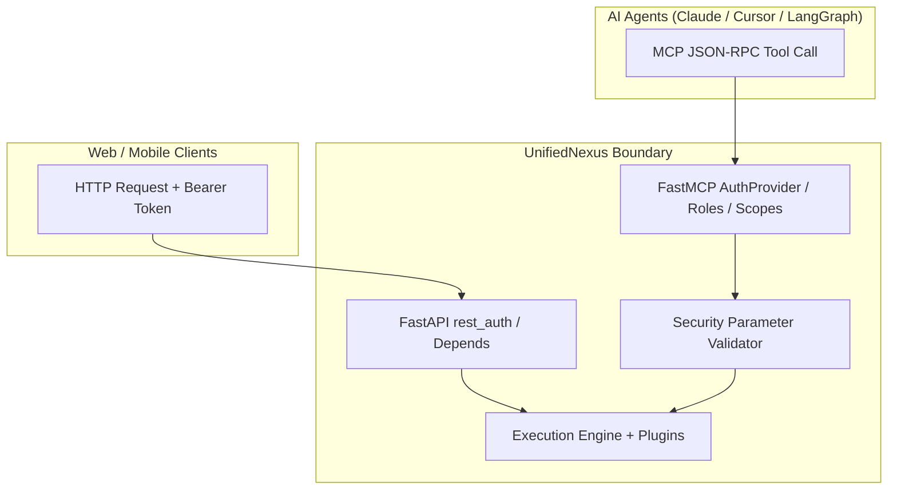

# UnifiedNexus ⚡

[](https://pypi.org/project/unified-nexus/)
[](https://pypi.org/project/unified-nexus/)
[](https://opensource.org/licenses/Apache-2.0)
[](https://github.com/rajboopathiking/UnifiedNexus/actions/workflows/ci.yml)

**One function. Two interfaces. Enterprise AI-agent tool serving for FastAPI + Model Context Protocol (MCP).**

UnifiedNexus is a lightweight, secure, and extensible Python framework that bridges the gap between traditional REST APIs and AI-agent tools. Build customer-facing backends where your web frontend and autonomous AI agents share the exact same logic, schemas, and execution paths — defined once, with fail-closed security and trusted boundaries.

---

## 🎯 The Problem: Interface Drift & Insecure Tool Exposure

In traditional agentic systems, developers create a FastAPI route, then **manually re-wrap it** as an MCP tool. Over time, schemas drift, authentication gets bypassed, and internal database handles leak into LLM prompts.

```
❌ Traditional Duplication (Vulnerable & Drifting)
├── routes/orders.py     ← HTTP logic with FastAPI Depends(get_current_user)
├── mcp/orders.py        ← Copy-pasted MCP tool (bypasses auth, leaks DB sessions)
└── models/orders.py     ← Schema drift between OpenAPI and LLM json-schema
```

```
✅ UnifiedNexus (Single Source of Truth, Secure Boundaries)
└── main.py              ← One function. One decorator. Dual interfaces. Fail-closed security.
```

---

## 📦 Installation

```bash
pip install unified-nexus
```

---

## 🚀 Quickstart

```python
from unified_nexus import UnifiedNexus, ToolSafetyLevel
from pydantic import BaseModel, Field

nexus = UnifiedNexus("CustomerAPI", version="0.2.0")

class UserRequest(BaseModel):
    user_id: int = Field(..., description="The unique ID of the user")

@nexus.universal_tool(path="/user-info", tool_type=ToolSafetyLevel.READ_ONLY, idempotent=True)
def get_user(req: UserRequest):
    """
    Fetches user status and clearance level.
    Docstrings and Pydantic schemas are auto-published to Swagger UI and MCP tools.
    """
    return {"id": req.user_id, "status": "Active", "tier": "Gold"}

# Build unified ASGI app
app = nexus.finalize()

if __name__ == "__main__":
    import uvicorn
    uvicorn.run(app, host="127.0.0.1", port=8000)
```

Run and inspect both interfaces simultaneously:
- 🌐 **REST API & Swagger Docs**: `http://localhost:8000/docs`
- 🤖 **MCP SSE Transport**: `http://localhost:8000/mcp`
- 🔍 **MCP Inspector**: `npx -y @modelcontextprotocol/inspector http://localhost:8000/mcp`

---

## 🛡️ Enterprise Security Model

UnifiedNexus treats REST and MCP as distinct transport boundaries. **REST authentication does not automatically secure MCP tools, and MCP tools must never receive credentials as LLM arguments.**



### 1. Fail-Closed Parameter Validation
- **No FastAPI `Depends()` in MCP**: Attempting to expose an endpoint containing `Depends(...)` or `Security(...)` with `expose="both"` or `expose="mcp"` immediately raises `SecurityConfigurationError`. FastAPI dependencies require HTTP headers and must not be blindly invoked in MCP.
- **No Credential Arguments in LLM Schemas**: Parameters named `password`, `token`, `secret`, or `api_key` are rejected from MCP registration, preventing LLMs from spoofing caller credentials.
- **Router Security Isolation**: APIRouters with router-level security dependencies (`router.dependencies`) cannot be converted to MCP without explicit MCP authorization policies.

### 2. Dual Authentication Configuration
```python
from fastapi import Depends, Header, HTTPException
from unified_nexus import UnifiedNexus

def verify_jwt(authorization: str = Header(None)):
    if not authorization or not authorization.startswith("Bearer "):
        raise HTTPException(status_code=401, detail="Missing Bearer Token")
    return True

# Separate REST and MCP authentication mechanisms
nexus = UnifiedNexus(
    "SecureService",
    rest_auth=Depends(verify_jwt),  # Protects REST endpoints
    mcp_auth=my_mcp_token_verifier, # Protects MCP endpoint
)
```

---

## 🧩 Extensible Plugin Architecture

Plugins run identically across **both REST and MCP** requests, providing unified auditing, rate limiting, and request tracing.

```python
from unified_nexus import NexusPlugin, NexusContext

class ComplianceAuditPlugin(NexusPlugin):
    async def startup(self, nexus):
        print("🚀 Compliance monitoring active.")

    async def before_execute(self, context: NexusContext, args: dict):
        print(f"[{context.request_id}] {context.transport.upper()} call to '{context.tool_name}'")

    async def after_execute(self, context: NexusContext, result: dict):
        print(f"[{context.request_id}] Executed in {context.duration_ms:.2f}ms")
        return result

    async def on_error(self, context: NexusContext, error: Exception):
        print(f"[{context.request_id}] Error in '{context.tool_name}': {error}")

nexus.add_plugin(ComplianceAuditPlugin())
```

### `NexusContext` Attributes
| Field | Type | Description |
| :--- | :--- | :--- |
| `transport` | `'rest' \| 'mcp'` | The invoking transport protocol |
| `tool_name` | `str` | Name of the active tool or endpoint |
| `request_id` | `str` | Unique UUID correlation ID for tracing |
| `principal` | `str \| dict \| None` | Verified identity of caller |
| `permissions` | `Set[str]` | Trusted authorization claims and roles |
| `duration_ms` | `float \| None` | Measured execution time |

---

## 🤖 AI-Agent Safety & Operational Invariants

| Invariant | Implementation | Benefit |
| :--- | :--- | :--- |
| **Tool Safety Levels** | `tool_type=ToolSafetyLevel.READ_ONLY \| ACTION \| DESTRUCTIVE` | Explicit capability classification |
| **Human Approval** | `approval_hook=...` or `requires_approval=True` | Destructive tools require confirmation |
| **Idempotency & Deduplication** | `idempotent=True` / `IdempotencyCache` | Safe retries & in-memory response deduplication |
| **Bounded Payloads** | `max_input_chars=100_000`, `max_output_chars=50_000` | Prevents prompt-injection context overflow |
| **Secrets Redaction** | `sanitize_message()` | Passwords, tokens, DB URLs masked with `***` |
| **Threadpool Sync** | `run_in_threadpool` | Slow synchronous tools never block async event loop |
| **Concurrency Limits** | `asyncio.Semaphore(concurrency_limit)` | Prevents agent swarms from exhausting resources |

---

## 🚀 Production Deployment & Readiness

UnifiedNexus v0.2.2 is hardened for production multi-worker environments:

- **Distributed Redis Idempotency**: Use `RedisIdempotencyBackend` with Redis `EVAL` support. Atomic Lua scripts (`LUA_COMPLETE`, `LUA_RELEASE`) govern key lifecycle fail-closed, ensuring that stale workers can never hijack replacement locks.
- **Post-Execution Failure Retention**: If a side-effecting action succeeds but result persistence or network transport fails, the reservation is retained, preventing automated agent retries from executing duplicate charges or mutations.
- **End-to-End Exactly-Once Semantics**: Forward `ctx.durable_idempotency_key` (`f"{caller_id}:{tool_name}:{idempotency_key}"`) to downstream transactional services (e.g. Stripe, SQL database with unique constraints) for durable deduplication beyond Redis key expiration.

📘 For the complete architecture guide and configuration checklist, see the **[Production Deployment Guide](docs/production-deployment.md)**.

---

## ⚙️ Exposure Control: App & Tool Levels

### 1. App-Level Exposure
```python
nexus = UnifiedNexus("App", expose="both")  # REST + MCP (default)
nexus = UnifiedNexus("App", expose="api")   # REST Only (MCP disabled)
nexus = UnifiedNexus("App", expose="mcp")   # MCP Only (Docs & REST disabled)
```

### 2. Tool-Level Exposure
```python
# REST Only
@nexus.api_only(path="/internal-metrics")
def get_metrics():
    return {"cpu": 15}

# MCP Only
@nexus.mcp_only(tool_type=ToolSafetyLevel.READ_ONLY)
def search_agent_memory(query: str):
    return {"matches": []}

# Dual REST + MCP
@nexus.universal_tool(path="/calculate", expose="both")
def calculate(a: int, b: int):
    return {"sum": a + b}
```

---

## 🏢 FastAPI Microservice Mounting

Attach UnifiedNexus directly onto existing production FastAPI applications with existing database pools and custom lifespans:

```python
from contextlib import asynccontextmanager
from fastapi import FastAPI
from unified_nexus import UnifiedNexus

@asynccontextmanager
async def database_lifespan(app: FastAPI):
    print("🔌 Connecting PostgreSQL pool...")
    yield
    print("🛑 Disconnecting PostgreSQL pool...")

existing_app = FastAPI(title="OrderService", lifespan=database_lifespan)
nexus = UnifiedNexus("OrderNexus")

# Mounts routes, normalizes /mcp mount path, and preserves database lifespan:
nexus.attach_to(
    existing_app,
    api_prefix="/api/v1",  # REST routes prefixed: /api/v1/...
    mcp_path="/",          # MCP accessible at /mcp without /mcp/mcp duplication
    mode="both",
)
```

---

## 🧪 Tested Compatibility Matrix

| Component | Supported Range | Tested Status |
| :--- | :--- | :---: |
| **Python** | `3.11`, `3.12`, `3.13` | ✅ Verified |
| **FastAPI** | `>= 0.115.0` | ✅ Verified |
| **FastMCP** | `>= 2.0.0` (including `4.1.0+`) | ✅ Verified |
| **Starlette** | `>= 0.40.0` | ✅ Verified |
| **Pydantic** | `>= 2.6.0` | ✅ Verified |

---

## 📄 License

Apache License 2.0. See [LICENSE](LICENSE) for details.
