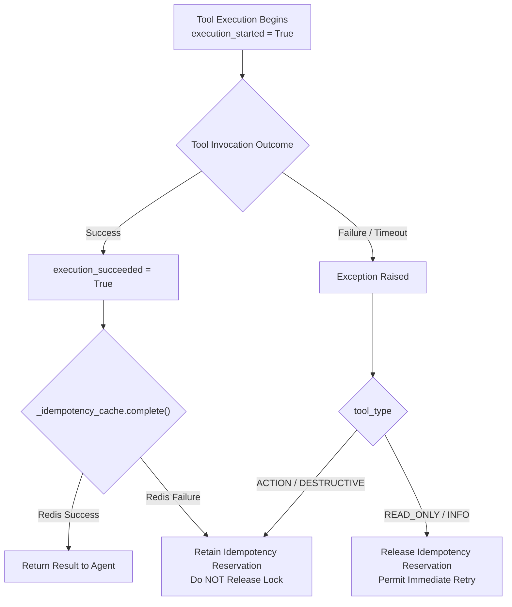

# Production Deployment Guide & Readiness Checklist

UnifiedNexus v0.2.2 is an enterprise-grade framework bridging FastAPI and Model Context Protocol (FastMCP). This guide outlines the shared responsibility model, configuration requirements, and best practices for deploying UnifiedNexus into production AI-agent environments.

---

## 1. Production Readiness Model

UnifiedNexus separates **Framework Correctness** from **Deployment Infrastructure**:

| Responsibility Layer | Owner | Status / Requirements |
| :--- | :--- | :--- |
| **Framework Layer** | UnifiedNexus v0.2.2 | **Production-Ready**: Atomic Lua lock verification, fail-closed auth, multi-tenant isolation, post-execution reservation retention, and dual-transport security boundaries verified across all test suites. |
| **Infrastructure Layer** | Cloud / DevOps | **Required**: High-availability Redis (Sentinel / Cluster / ElastiCache), AOF persistence, network security, and worker process supervision. |
| **Business Data Layer** | Application Service | **Required**: Durable idempotency tables (database unique constraints) or upstream payment gateway keys utilizing `ctx.durable_idempotency_key`. |

---

## 2. Production Deployment Checklist

Before exposing UnifiedNexus to unrestricted agent or user traffic in production, verify the following configuration points:

| Priority | Check | Requirement | Why It Matters |
| :---: | :--- | :--- | :--- |
| **CRITICAL** | **Redis Backend** | Use `RedisIdempotencyBackend` instead of default in-memory cache | In-memory caching only coordinates within a single process. Multi-worker deployments (Uvicorn / Gunicorn / Kubernetes pods) require a shared Redis instance. |
| **CRITICAL** | **Redis Lua Capability** | Ensure Redis server supports `EVAL` (standard Redis 2.6+) | UnifiedNexus enforces atomic lock ownership via Lua scripts (`LUA_COMPLETE`, `LUA_RELEASE`). Environments without `eval` fail closed with `SecurityConfigurationError`. |
| **CRITICAL** | **Dual Authentication** | Explicitly configure both `rest_auth` and `mcp_auth` | REST authentication does not protect MCP tools, and MCP authentication does not protect REST. Authenticate both transport boundaries. |
| **HIGH** | **Durable Business Idempotency** | Persist `ctx.durable_idempotency_key` in database or downstream payment APIs | Redis idempotency keys have an expiry (`lock_timeout`). Critical monetary or destructive actions require durable ledger storage to prevent duplicates across long-term retries. |
| **HIGH** | **Action Tool Classification** | Mark state-modifying operations with `tool_type=ToolSafetyLevel.ACTION` or `DESTRUCTIVE` | UnifiedNexus retains reservations on failures only for side-effecting tools. Misclassifying an action as `READ_ONLY` causes immediate release upon failure. |
| **HIGH** | **Async Handlers for Actions** | Define state-modifying tools as `async def` | Synchronous (`def`) tools run in a threadpool; if they time out, worker threads continue in the background. `async def` allows immediate cancellation. |
| **MEDIUM** | **Payload & Output Bounds** | Tune `max_input_chars` and `max_output_chars` | Prevents prompt-injection context exhaustion and denial-of-service from runaway LLM payloads. |
| **MEDIUM** | **Monitoring & Alerting** | Monitor HTTP 504 and `ToolTimeoutError` | A spike in timeouts indicates slow downstream dependencies or concurrent retry contention. |

---

## 3. Configuring the Distributed Redis Backend

For multi-worker deployments (Kubernetes, ECS, Docker Swarm, or multi-process Uvicorn), configure a shared Redis client:

```python
import os
import redis.asyncio as aioredis
from unified_nexus import UnifiedNexus, RedisIdempotencyBackend

# 1. Connect to high-availability Redis (Sentinel, Cluster, or managed service)
redis_client = aioredis.from_url(
    os.getenv("REDIS_URL", "redis://redis-cluster.internal:6379/0"),
    encoding="utf-8",
    decode_responses=False, # Backend handles byte-level serialization
    socket_timeout=2.0,
    socket_connect_timeout=2.0,
    health_check_interval=30,
)

# 2. Initialize Redis idempotency backend
idempotency_backend = RedisIdempotencyBackend(
    redis_client=redis_client,
    key_prefix="nexus:idempotency:",
)

# 3. Mount backend to UnifiedNexus
nexus = UnifiedNexus(
    "EnterpriseService",
    idempotency_backend=idempotency_backend,
    default_timeout=30.0,
    max_concurrency=100,
)
```

### Redis Configuration Recommendations
- **Persistence**: Enable Append-Only File (`appendonly yes` with `appendfsync everysec`) so reservations survive unexpected Redis restarts.
- **Eviction Policy**: Use `noeviction` or `volatile-lru` on your idempotency database to prevent Redis from prematurely evicting active `PENDING` locks under memory pressure.

---

## 4. End-to-End Exactly-Once Pattern for AI Agents

UnifiedNexus guarantees atomic in-flight locking and short-term deduplication. For mission-critical side effects (e.g., payments, account modifications, resource provisioning), pair UnifiedNexus with **downstream business durability**:

```python
from unified_nexus import UnifiedNexus, ToolSafetyLevel, NexusContext
from pydantic import BaseModel

class ChargeRequest(BaseModel):
    amount_cents: int
    idempotency_key: str

@nexus.universal_tool(
    path="/billing/charge",
    tool_type=ToolSafetyLevel.ACTION,
    idempotent=True,
    timeout=10.0,
)
async def process_charge(req: ChargeRequest, ctx: NexusContext):
    """
    Executes a financial charge with end-to-end exactly-once semantics.
    """
    # 1. Qualified durable idempotency key formatted as:
    #    "tenant:{tenant_id}:user:{user_id}:{tool_name}:{idempotency_key}"
    durable_key = ctx.durable_idempotency_key

    # 2. Forward durable key directly to transactional downstream APIs
    #    (e.g., Stripe, database ledger table with UNIQUE constraint)
    charge_result = await payment_gateway.create_charge(
        amount=req.amount_cents,
        idempotency_key=durable_key,
    )

    return {"charge_id": charge_result.id, "status": "succeeded"}
```

### Why this is resilient:
1. **Network Retries within Window**: Handled automatically by UnifiedNexus via Redis atomic caching.
2. **Post-Execution Network Glitch**: If the payment gateway succeeds but the Redis connection drops, UnifiedNexus retains the reservation. Immediate retries cannot re-execute the charge.
3. **Long-Term Retry (Post-TTL)**: If the agent retries days later after Redis TTL expires, the downstream payment gateway or database ledger detects the same `durable_key` and rejects the duplicate.

---

## 5. Side-Effect Failure Recovery & Monitoring

UnifiedNexus differentiates tool execution failures from result storage failures:



### Operational Observability
Configure your APM (Datadog, OpenTelemetry, Prometheus) to monitor these key indicators:
- **HTTP 504 / `ToolTimeoutError`**: Elevated rates suggest background worker thread exhaustion or downstream service latency.
- **HTTP 409 / `IdempotencyConflictError`**: Indicates that an agent reused an existing idempotency key with altered parameters (parameter tampering or bug in agent client).
- **Audit Hook Errors**: Ensure your `audit_hook` is non-blocking or wrapped in `try/except` so logging glitches never disrupt primary execution.

---

## 6. Recommended Rollout Strategy

1. **Canary / Pilot Phase**:
   - Deploy UnifiedNexus to a staging environment and a controlled internal pilot.
   - Run synthetic multi-agent tests with simulated network partitions and concurrent tool submissions.
2. **Alert Thresholds**:
   - Set warning alerts for Redis latency exceeding 100ms.
   - Set error alerts for repeated `AuthorizationError` or `SecurityConfigurationError` occurrences.
3. **Graceful Degradation**:
   - Ensure clients implement exponential backoff with jitter on HTTP `504` and `500` status codes.
